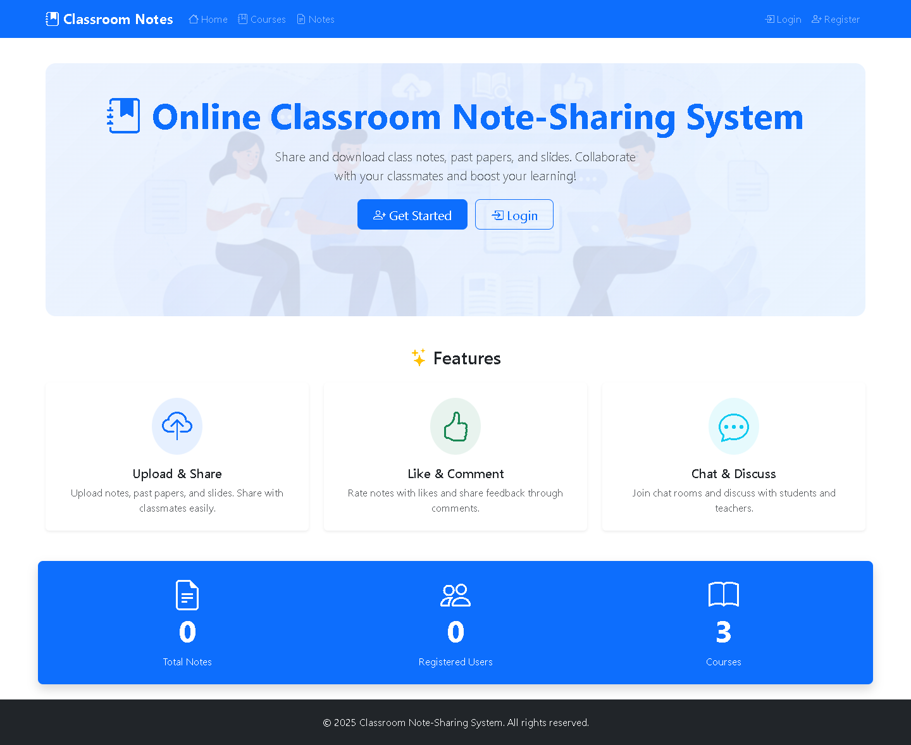
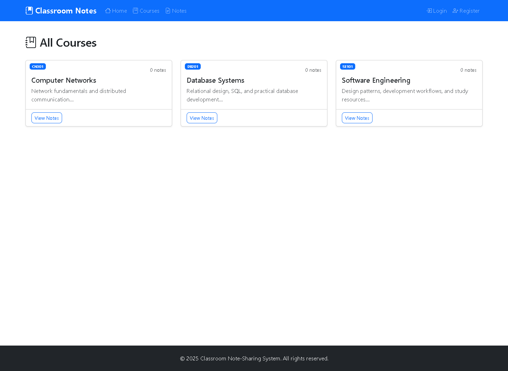

# Classroom Notes Hub

A Flask learning portal for sharing course notes, moderating uploads, and discussing study material through real-time chat.



## What you can do

- Register and sign in as a student; manage your profile and change your password.
- Browse courses and approved notes, upload study files, like notes, and add comments.
- Review and approve submissions through the administrator dashboard.
- Manage users, course records, and student/teacher/admin roles.
- Create chat rooms, exchange Socket.IO messages, and receive notifications.



## Run locally

Requires Python 3.10 or newer, pip, and a modern browser. SQLite is included with Python; no database server is required. The release checks ran on Windows with Python 3.13. External CDNs supply Bootstrap and related interface assets.

```powershell
git clone https://github.com/sheikhabdullah9july-commits/classroom-notes-hub.git
cd classroom-notes-hub
py -3.11 -m venv .venv
.\.venv\Scripts\python.exe -m pip install --upgrade pip
.\.venv\Scripts\python.exe -m pip install -r requirements.txt
Copy-Item .env.example .env
```

Replace `SECRET_KEY` in `.env` with a long random value. Generate one with:

```powershell
.\.venv\Scripts\python.exe -c "import secrets; print(secrets.token_hex(32))"
.\.venv\Scripts\python.exe create_admin.py
.\.venv\Scripts\python.exe run.py
```

The admin helper asks for a username, email, and password of at least 12 characters. There is no shared default admin account. Open **http://127.0.0.1:5000**. On first startup the application creates `app.db` and the private `uploads/` directory automatically. Start from the project root.

## First-use walkthrough

1. Create the administrator with `create_admin.py` and sign in.
2. Add a course through the Courses page.
3. Sign out and register a student account.
4. Open the course and upload a document or image.
5. Sign in as administrator and approve the pending submission.
6. Browse/download the approved note, add a comment, or join a chat room.

Uploads accept PDF, DOC/DOCX, PPT/PPTX, TXT, PNG, and JPEG with a 16 MB request limit. They are stored outside public static assets; unapproved note views and downloads are restricted to the author and administrators. Upload filenames include unique identifiers to avoid collisions.

## Configuration

| Variable | Purpose |
|---|---|
| `SECRET_KEY` | Persistent session signing secret; set a unique value in `.env`. |
| `DATABASE_URL` | Optional SQLAlchemy database URI; defaults to local SQLite. |
| `FLASK_DEBUG` | Set `1` for local development debugging; default is off. |
| `MAIL_SERVER`, `MAIL_PORT`, `MAIL_USERNAME`, `MAIL_PASSWORD` | Mail settings reserved for an actual delivery integration. |

The previous password-reset demonstration exposed recovery tokens directly to a requester. Those routes now return **503** by default until email ownership verification is implemented. Changing your password while signed in remains available. Mail configuration alone does not implement secure recovery. Avoid enabling the internal `ALLOW_INSECURE_DEMO_RESET` flag on any shared system.

## Project layout

```text
run.py                 Local Flask-SocketIO entry point
config.py              Environment and application settings
create_admin.py        Interactive administrator bootstrap
app/models.py          Users, courses, notes, comments, chat, notifications
app/routes/            Authentication and feature blueprints
app/templates/         HTML pages
app/static/            CSS and bundled interface imagery
tests/                 Workflow and access-control regression checks
docs/                  Screenshots, original attribution, and review notes
```

## Validation

```powershell
.\.venv\Scripts\python.exe -m unittest discover -s tests -v
```

Four tests cover public pages, registration privilege restrictions, upload/approval/download, anonymous chat rejection, disabled insecure recovery, and external redirect rejection. Screenshots show the running app with synthetic course data. See [review notes](docs/REVIEW.md) and [release inventory](docs/RELEASE-CONTENTS.md).

This is a local demonstration, not a hardened hosted learning platform. CSRF coverage, rate limiting, file-content inspection, complete input validation, and browser-level multi-user chat testing still need work. Do not expose the development server directly to the internet. A fresh installation of the supplied pinned requirements and all four tests also passed on Windows/Python 3.13. [Test environment versions](docs/TEST-ENVIRONMENT.md) record both environments used for this review.

## Attribution

The supplied `Dec` project points to [Online-Classroom-Note-Sharing-System](https://github.com/saiteja22122212-dotcom/Online-Classroom-Note-Sharing-System). Its original README credits **Usama Nadeem, Urvi Madane, Sai Teja Kancharla, and Avinash Reddy Vontela**. That attribution is preserved in [the original README](docs/ORIGINAL-README.md). This release adds documentation, tests, safer bootstrap/configuration, and access-control fixes. No new open-source license is assigned; public visibility does not replace permission from the relevant rights holders.
